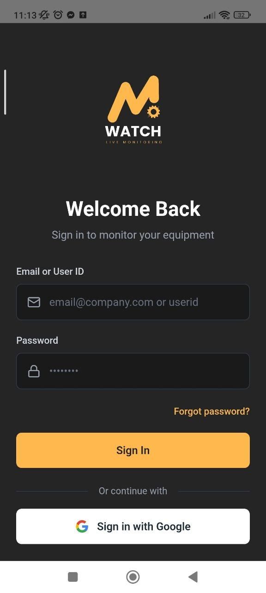
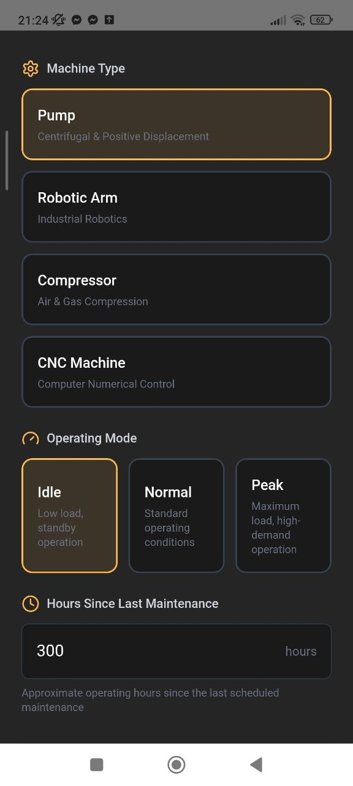
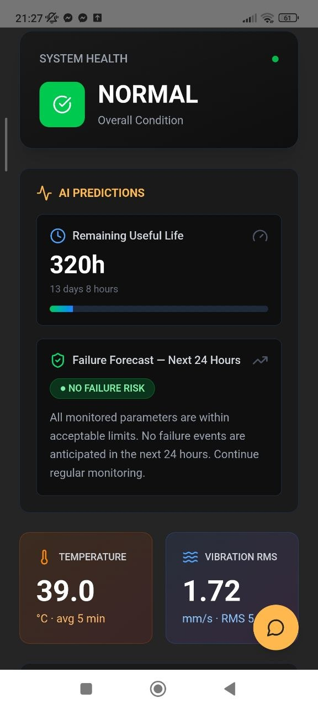
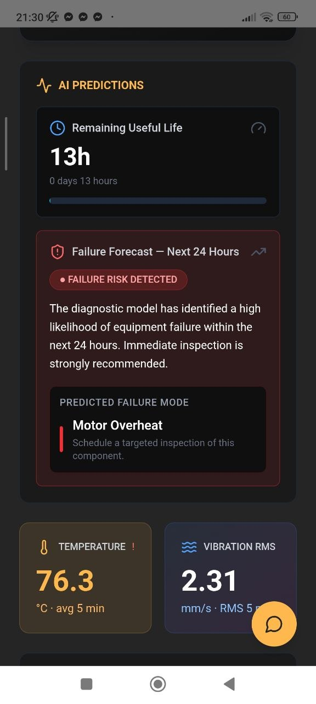
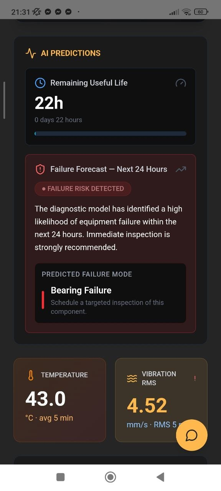
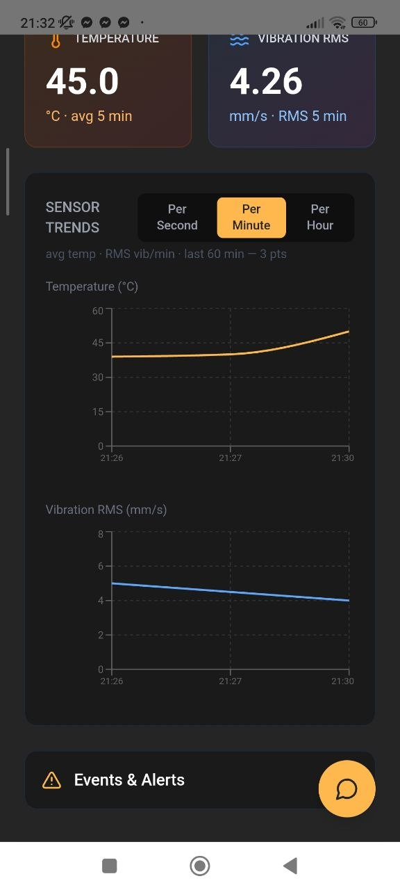
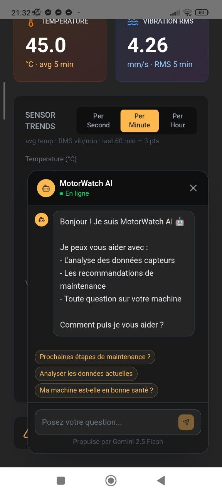
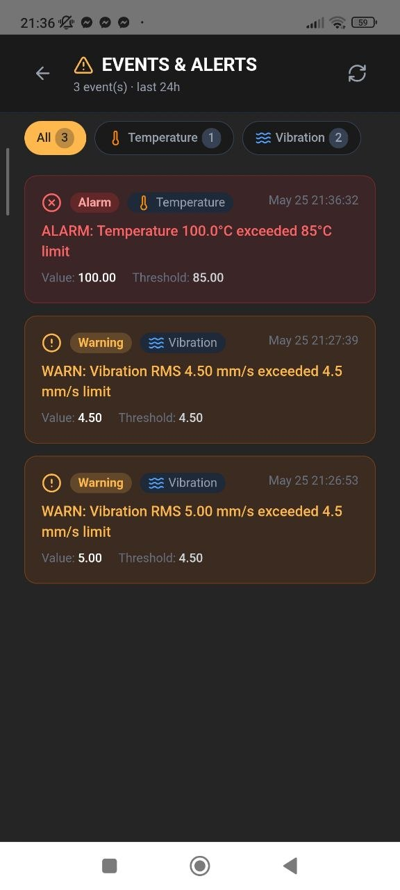
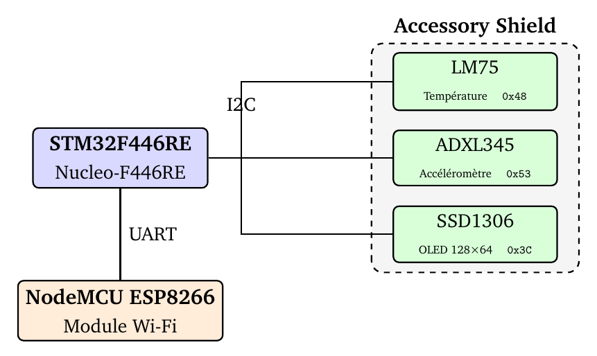
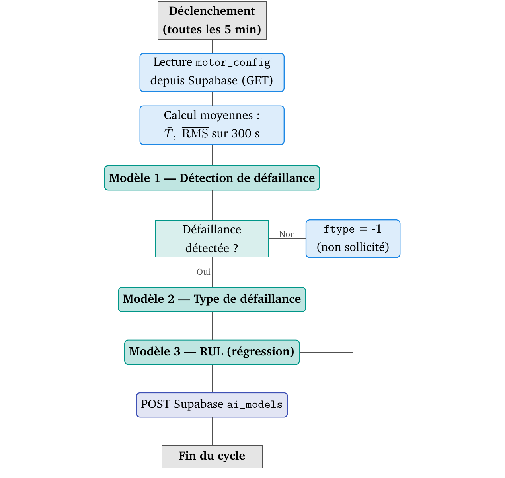

# MotorWatch

Real-time health monitoring and predictive maintenance for electric motors, with the AI running on a microcontroller.

Website: [motorwatch.tech](https://motorwatch.tech)

MotorWatch measures the temperature and vibration of a motor, runs three small neural networks on an ESP32-S3 gateway, stores the results in Supabase and shows them in an Android app. We built it as our end-of-year engineering project (PFA) at ENICarthage, Embedded Systems track, 2025-2026.

The three models estimate the remaining useful life (RUL), detect a coming failure and name the likely cause: a bearing problem or motor overheating. A chatbot in the app turns those outputs into maintenance advice.

## How it works

```
STM32F446RE + sensors --UART--> ESP8266 --Wi-Fi / HTTP--> ESP32-S3 gateway --HTTPS--> Supabase --Realtime--> Android app
(LM75, ADXL345, OLED)                                     (3 Edge Impulse models)                          (+ Gemini chatbot)
```

1. **Node.** The STM32 reads a temperature sensor and a 3-axis accelerometer, computes a vibration RMS value and sends one text frame per second over UART.
2. **Relay.** The ESP8266 does no processing. It forwards each frame to the gateway over Wi-Fi using HTTP.
3. **Gateway.** The ESP32-S3 parses the frames, pushes raw readings to Supabase every second, and every 5 minutes runs the models on 300-second averages.
4. **Cloud and app.** Supabase stores everything. The Android app subscribes to it in real time and shows live curves, predictions and alerts.

Several nodes can share one gateway. The input vector includes the machine type, so you don't retrain the models to watch a different motor.

## Hardware

| Part | Role |
|---|---|
| STM32 Nucleo-F446RE | Sensor acquisition and FreeRTOS application |
| Accessory Shield | LM75 temperature sensor (I2C 0x48), ADXL345 accelerometer (0x53), SSD1306 OLED 128x64 (0x3C) |
| NodeMCU ESP8266 | Wi-Fi relay between the node and the gateway |
| ESP32-S3 | Gateway: Edge AI inference and cloud upload |

## Node firmware

The STM32 runs three FreeRTOS tasks that share data through a mutex:

- `Task_Vibration` samples the ADXL345 every 390 µs (2560 Hz). A vibration is flagged when the acceleration magnitude differs from 1 g by more than 0.35 g. This threshold is a default and needs calibration for each motor. The RMS is computed over a sliding window of 50 samples.
- `Task_Temperature` reads the LM75 (0.125 °C per step) and draws a temperature bar on the OLED, redrawing only the part that changed.
- `Task_UART` sends a frame every second in the format `T:XX.XX RMS:X.XXXX`.

## AI models

All three models are fully connected networks (4 dense layers of 64, 32, 16 and 8 neurons with dropout), trained on Edge Impulse and exported as Arduino libraries (`failurenew_inferencing`, `ftypenew_inferencing`, `rul_inferencing`) in quantized TFLite INT8 and float32. They run in a few milliseconds on the ESP32-S3, and the three memory arenas together take under 11 KB of RAM.

The training data is a public Kaggle predictive maintenance dataset: 22,660 observations from four machine types (CNC, compressor, pump, robotic arm). The inputs are machine type, vibration RMS, motor temperature, operating mode (idle, normal, peak) and hours since the last maintenance.

| Model | Task | Result on the test set |
|---|---|---|
| Remaining useful life | Regression, hours left | RMSE 11.56 h, MAE 8.88 h, R² 0.80 |
| Failure detection | Binary classification | Accuracy 89.51 %, F1 0.91 |
| Failure type | Bearing or motor overheating | Accuracy 94.12 %, F1 0.93 |

These numbers come from a test split of the dataset, not from field measurements. The failure type model was trained on the 2,170 failure observations only (1,117 bearing, 1,060 overheating) and uses four inputs, without the maintenance hours.

Each 5-minute cycle works like this: the gateway reads `motor_config`, computes the 300-second averages, runs failure detection, and runs the failure type model only if a failure was detected (otherwise `ftype` is stored as -1). The RUL model runs every cycle.

## Database

Supabase (PostgreSQL) holds three tables:

- `sensor_data`: one row per second with `temperature`, `rms` and `source`. It feeds the live charts.
- `ai_models`: one row every 5 minutes with the failure class and confidence, the failure type and confidence, `rulhours`, `avg_temp` and `avg_rms`.
- `motor_config`: the machine type, operating mode and hours since maintenance, entered by the technician in the app and read by the gateway before each inference.

## Mobile app

React and TypeScript, packaged for Android with Capacitor 8. It includes:

- Login with email and password or Google OAuth, and a password reset by 6-digit code sent by email.
- A machine setup screen (type, operating mode, hours since maintenance).
- A dashboard with the RUL, the 24-hour failure forecast, the predicted failure mode, current temperature and vibration, and trend charts per second, minute and hour.
- An events screen listing threshold alerts (the demo screens use 85 °C and 4.5 mm/s) and local push notifications.
- A chatbot built on Gemini 2.5 Flash that receives the current readings and predictions and answers as a maintenance expert.

### Screenshots

<table>
  <tr>
    <td></td>
    <td></td>
    <td></td>
    <td></td>
  </tr>
  <tr>
    <td></td>
    <td></td>
    <td></td>
    <td></td>
  </tr>
</table>

## Diagrams

The node hardware:



The 5-minute inference cycle on the gateway:



The app's [use case diagram](docs/images/use-case-diagram.png), [class diagram](docs/images/class-diagram.png) and [sequence diagram](docs/images/sequence-diagram.png) are in `docs/images`.

## Repository structure

```
motorwatch/
├── firmware/
│   ├── stm32-node/        STM32CubeIDE project (FreeRTOS, drivers)
│   ├── esp8266-relay/     Arduino sketch
│   └── esp32s3-gateway/   Arduino sketch + Edge Impulse libraries
├── app/                   React + Capacitor Android app
├── supabase/              Database schema
├── docs/                  Project report and images
└── README.md
```

## Getting started

You need an STM32 Nucleo-F446RE with the Accessory Shield, a NodeMCU ESP8266, an ESP32-S3 board, a Supabase project and a Wi-Fi network.

1. **Supabase.** Create a project and apply `supabase/schema.sql`. Turn on Realtime for `sensor_data` and `ai_models`, and add one row to `motor_config`.
2. **STM32.** Open `firmware/stm32-node` in STM32CubeIDE, build and flash the board.
3. **ESP8266.** Copy `secrets.example.h` to `secrets.h`, set your Wi-Fi credentials and the gateway address, then upload the sketch from the Arduino IDE.
4. **ESP32-S3.** In the Arduino IDE, install the three Edge Impulse libraries with Sketch > Include Library > Add .ZIP Library. Select the board `ESP32S3 Dev Module`, fill in `secrets.h` (Wi-Fi, Supabase URL and key) and upload.
5. **App.** From the `app` folder:

   ```bash
   npm install
   cp .env.example .env     # add your Supabase URL, anon key and Gemini key
   npm run dev              # run in the browser
   npm run build
   npx cap sync android
   npx cap open android     # build and run from Android Studio
   ```

Real keys and passwords never go in the repository. Only the `*.example` files are committed.

## Known limitations

- The ESP32-S3 talks to Supabase over a TLS client that does not verify the server certificate. This has to change before any production use.
- The app reads the Gemini key from a Vite environment variable, which puts it in the app bundle. A production version should call Gemini through a server function.
- The vibration threshold needs calibration for each motor type.
- The models were trained on a public dataset and have not been retrained on data from the target motor.

## Roadmap

- Multi-node support: index incoming frames by source and add a `node_id` column to the tables.
- Retraining on field data collected during deployment.
- Full certificate validation for the cloud connection.
- Deep sleep on the node for battery-powered setups.
- A security layer for the node and gateway link: signed and sequenced frames, per-device keys and read protection on the STM32.

## Authors

- Nader Gasmi
- Ayoub Chaieb

Supervised by Faten Salem. École Nationale d'Ingénieurs de Carthage, Département Génie Électrique, Embedded Systems track, academic year 2025-2026.

## License

MIT. See [LICENSE](LICENSE).
